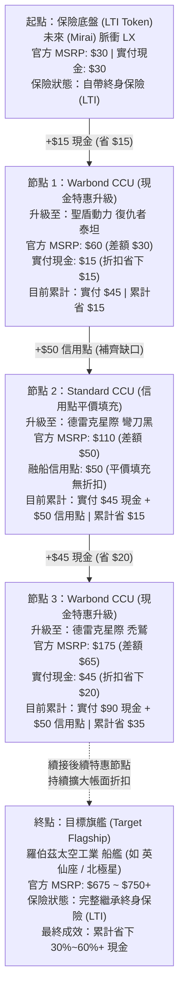
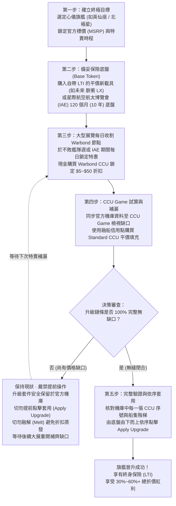

# 附錄 E：艦隊省錢魔法：CCU 跨底盤升級完全指南與最佳實踐

在《星際公民》的浩瀚宇宙中，擁有一艘屬於自己的多功能主力艦或大型專用艦船，是無數公民的終極夢想。然而，面對動輒數百美元的旗艦級官方定價，資深老兵們往往有一套心照不宣的「星際省錢魔法」——**CCU 鏈條升級 (CCU Chaining)**。

透過這套官方完全合法認可的商城補差價升級機制，玩家能以極低甚至接近半價的總支出，將心儀的中大型乃至主力艦艇收入囊中，並永久享有終身保險 (LTI)。本篇指南將為你徹底揭密 CCU 的核心機制、運作原理、避坑鐵則以及業界標準的五步實戰流程。

---

## 核心升級概念 (Core Concepts)

要掌握升級鏈的精髓，首先必須釐清以下六大核心支柱：

### 1. 什麼是 CCU (Cross-Chassis Upgrade / 跨底盤升級)

CCU 是 Cloud Imperium Games (CIG) 官方商城提供的一項船艦升級機制，允許玩家將已擁有的船隻，升級為另一艘官方定價更高的目標船隻。

* **計算原則**：差價永遠以目標艦船的**當前官方標價 (MSRP)** 減去 起始艦船的**當前官方標價**計算，而非你當初實際購買該船時花費的金額。
* **保留特性**：原船的遊戲資格包 (Game Package)、自帶塗裝與其他附加物品均會完整繼承，且在升級鏈中會自動以最高保險優先級覆蓋。

### 2. LTI Token (終身保險底盤)

終身保險 (Lifetime Insurance, 簡稱 LTI) 意味著你在遊戲正式上線後，該艦船的基礎底盤將享有永久免費的保險理賠權益。

* 在 CCU 策略中，老玩家通常不會直接購買高價的原始 LTI 大船，而是利用官方在概念特賣或重大節慶中新推出的小型平價載具（如 **未來 (Mirai) 脈衝 / 脈衝 LX**、**未來 (Mirai) 狂怒**、**德雷克星際 小刀** 等，通常定價 $20–$45 美元）作為升級鏈的「地基底盤」（即 **LTI Token**）。
* 只要底盤自帶 LTI，後續無論跨過多少個升級階梯，最終目標旗艦都能完整繼承這份終身保險！

### 3. Warbond CCU (現金特惠升級)

官方在每年大型展覽活動（如 5 月的 **不敗艦隊週 (Invictus Launch Week)**、6 月的 **外星週 (Alien Week)**、11 月的 **星際航空航太博覽會 (IAE)**）以及重大特賣期間，會針對特定艦船每日輪流推出 **Warbond CCU**。

* **限定現金**：Warbond 升級必須使用全新現金（信用卡 / PayPal 等）付款，不可使用帳號內既有的融船信用點 (Store Credit)。
* **折價紅利**：官方會為 Warbond 升級提供 $5 至 $50 美元不等的帳面折扣。舉例來說，一艘原本差額需補 $25 的升級，Warbond 現金特惠可能只需支付 $10，瞬間為你省下 $15！

### 4. CCU 鏈條 (CCU Chain)

所謂「鏈條」，就是將多個不同階梯的 Warbond CCU 串聯成一條長長的升級路徑。

* 例如：基礎底盤 -> 節點 A（省 $15）-> 節點 B（省 $20）-> 節點 C（省 $30）-> 最終旗艦（如**羅伯茲太空工業**的**英仙座**或**北極星**）。
* 當多個 Warbond 節點的帳面折扣層層疊加時，最終整艘旗艦的真實入手花費往往只需原價的 40% ~ 70%，節省高達 30%~60% 甚至更多現金支出！

### 5. Store Credit CCU (信用點升級填充)

在升級鏈條中，並不是每個價格區間都能剛好買到 Warbond 特惠。此時，玩家可以將平時閒置在機庫中的裝備或無用小船融解為帳號信用點 (Store Credit)。

* 利用信用點購買無折扣的標準 Standard CCU，來填補兩個 Warbond 特惠節點之間的無特惠平價區間 (Fillers)，達成「部分現金融合、部分點數填充」的最優預算配置。

### 6. 概念漲價紅利 (Flight Ready Price Jump)

CIG 官方在公布未實裝的概念船隻 (Concept Ships) 時，其定價通常較低；而當該船隻在未來的重大版本正式飛上天空 (Flight Ready) 時，官方通常會調漲其標價 15% ~ 30% 不等。

* 若你在概念期以較低的 MSRP 鎖定了該船的 CCU，當它正式實裝可飛時，這筆官方調漲的金額將直接轉化為額外的「免費差價紅利」，讓後續升級至更高階艦船的成本再次驟降！

---

## 關鍵鐵則與避坑須知 (Essential Rules & Pitfalls)

CCU 雖能帶來驚人折扣，但背後也有極為嚴格的官方邏輯限制。若未諳規則，稍有不慎就可能導致心血泡湯：

### 1. 單向不可逆，且已無零元升級 ($0 CCU)


* **只能向上升級**：CCU 僅允許由低價船隻升級至更高價船隻，**絕不可逆向下行**，亦無法橫向平移升級同等價值的船隻。
* **最小升級門檻**：官方已徹底廢除早期的 $0 CCU 機制，目前商城中最小的 CCU 升級差額門檻為 **$5 美元**。


### 2. 切勿過早套用 (Never Apply Prematurely)


* **未套用前最具彈性**：購買的升級套件會存放在官方「My Hangar」中。在**整條升級鏈所有節點全部買齊、確認無缺口**，且你確實打算立刻在遊戲中開船之前，**絕對不要點擊「Apply Upgrade」**！
* 未套用的 CCU 可以隨時退融成 Store Credit 或在二手市場與好友轉讓；一旦點擊套用，船隻底盤便與升級件融合，中間所有節點皆無法單獨拆解。


### 3. 融船 (Melt) 的殘酷真相


**新手最常犯的災難性錯誤！**
* **僅退還實付總額**：若你將一艘已經套用了多張 Warbond CCU 的飛船融解成 Store Credit，系統**只會退還你實際支付的現金與信用點總額**。
* **折扣永久蒸發**：升級鏈條中所有 Warbond 節點為你省下的帳面折扣將**當場永久蒸發**！
* **回購清單無法救回升級件**：融船後，該船在回購清單 (Buy Back Pledges) 中只會還原為**最原始的底盤船隻**，中間套用的所有升級件全部消失，無法從回購清單中以折扣價購回！



**2026/11/01 官方商城新制：Game Access 保護機制與「永久無法融船」禁令**
* **受保護包永久鎖定 (Non-meltable & Non-giftable)**：自 2026 年 10 月起，CIG 官方導入全新「Game Access (遊戲存取保護)」庫存系統，並定於 **2026/11/01** 截止首期調整期。帳號中被指定為 Game Access 的主要遊戲包將享有遊戲存取保護，但**永久禁止融解 (Non-meltable)** 且**永久無法轉贈 (Non-giftable)**！
* **2026/11/01 永久鎖定大限**：在 2026/11/01 截止日前，玩家尚可在官方「My Hangar -> Game Access」頁面自由指定與更換保護包；**一旦逾期，系統將永久鎖定當前指定的遊戲包，未來完全無法更換或撤銷保護**。
* **高價船包資金鎖死災難 (Fund Lock Trap)**：若玩家誤將包含高額 CCU 鏈條的大型船包或昂貴多船包（如 UEE Exploration Pack）指定為 Game Access 保護包，該船包內包含的所有差額現金與升級價值將**永久被鎖死，永遠無法融解為 Store Credit 重新調配**！


### 4. 未套用 CCU 進入回購後的調價補差額限制


* 若你將「未套用的 CCU」融解進回購清單，只要目標船隻在日後調漲了官方標價 (MSRP)，當你未來想使用每季的回購代幣 (Buy Back Token) 將該 CCU 買回時，系統會**強制要求你以最新的漲價後原價補足差額**，原始的低價優惠將不復存在。因此未套用的優質 CCU 請妥善保存在機庫中，切勿隨意融解。


### 5. 保險繼承原則：最高等級生效


* 一艘飛船在經過連續升級後，系統只會採用整條升級鏈（底船與所有 CCU）中**最高等級的一份保險**生效。
* 保險階級順序為：**LTI (終身保險) > 120 個月 (星際航空航太博覽會 IAE / 10 年保險) > 24 個月 > 6 個月**。
* 只要底船具有 LTI，後續 CCU 即使只附帶 6 個月保險，最終船艦仍為 LTI；反之，若底盤僅有 6 個月保險，但中間某張 Warbond CCU 包含 120 個月星際航空航太博覽會 (IAE) 保險，則整艘船會升級為 120 個月保險。


### 6. 守護唯一的遊戲包 (Game Package)


* **遊玩核心憑證**：要進入《星際公民》伺服器遊玩，你的帳號機庫內必須至少保有一份包含「Star Citizen Digital Download」的遊戲包。
* **Game Access 雙刃劍**：在 2026/11/01 新制上線後，被指定為 Game Access 的遊戲包可有效避免新手因誤操作將遊戲包融解；但代價是該包**永久無法融解**，失去任何日後變現為 Store Credit 的靈活性。



**最佳實踐：保護包選擇與獨立船艦 (Standalone Ship) 策略**
* **策略 1：鎖定最便宜的基礎新手包**：在「My Hangar -> Game Access」中，永遠將官方定價最低的基礎新手包（如 $45 美元的羅伯茲太空工業 極光 MR / 星際公民首航包）指定為保護包。即使日後完全不開這艘小船，也只需佔用最小額度的資金來滿足進服資格。
* **策略 2：禮賓大客 (Concierge) 享有永久免費 Game Access**：累計課金達 $1,000 美元解鎖禮賓俱樂部 VIP 資格後，系統會自動在 Game Access 綁定終身免費的遊戲存取權限，無需再消耗任何遊戲包。
* **策略 3：高額 CCU 鏈條務必做在獨立船艦 (Standalone Ship) 上**：強烈建議不要在受保護的遊戲包上堆疊昂貴的 CCU 升級鏈！請一律購買便宜的 LTI Token 獨立船艦（如脈衝、狂怒、小刀等）作為升級底盤。獨立船艦不受 Game Access 鎖定限制，隨時可享有 100% 融解為 Store Credit 重新洗牌艦隊的完整自由度！


---

## 輔助神器實戰 (Community Tools)

手動在紙筆或試算表上計算數十個 CCU 節點既繁瑣又容易出錯。善用全球社群開發的頂尖輔助工具，能讓你的艦隊構建事半功倍：

### 1. CCU Game (`ccugame.app`)

全宇宙公認的升級鏈規劃終極神器！

* **官方機庫同步**：透過官方瀏覽器擴充功能安全同步機庫資料，在登入 RSI 官網的狀態下一鍵安全讀取你當前機庫中擁有的所有船隻、未套用 CCU 以及回購清單。
* **升級樹狀視覺化**：自動將你的所有可能升級節點繪製成清楚的分支路徑樹狀圖，並即時計算目前已達成的總折扣率。
* **缺口自動計算機 (Gaps Finder)**：輸入你想獲得的目標艦船（如**聖盾動力 復仇者 泰坦**、**德雷克星際 小刀**、**羅伯茲太空工業 英仙座**或**北極星**），系統會自動推薦缺口最省路徑 (Gaps Finder)，比對當前活動正在特賣的所有 Warbond CCU，推薦花費最少現金與信用點的最佳接駁方案！

### 2. Star Citizen Hangar Xplorer

必備的官網機庫強化外掛插件。

* **結構化整頓**：RSI 官網的機庫頁面隨著購買紀錄增加會變得冗長混亂。Hangar Xplorer 能為你的機庫新增分類篩選器，視覺化機庫估值、LTI 標籤與升級歷程。
* **即時價值統計**：清楚列出機庫內每艘船隻的實際支付價值 (Melt Value) 與官方標價 (MSRP)，並完整記錄每一艘船的升級套用歷程。

---

## 五步最佳實踐流程 (Best Practice Workflow)

想親手打造一艘省下數百美元的夢想艦隊？請遵循這套成熟的五步最佳實踐流程：



### 第一步：確立終極目標 (Define the Target)

* 決定你最終想擁有的目標艦船（例如大型採礦機、戰鬥旗艦或專業工業艦）。
* 查詢該船當前的官方 MSRP 標價，並確保該目標艦船在官方活動中開放升級購買（通常在 5 月不敗艦隊週、6 月外星週或 11 月星際航空航太博覽會期間全開放）。



### 第二步：備妥 LTI/10 年保險底盤 (Secure the Base Token)

* 在新概念載具發售時（如 **未來 (Mirai) 脈衝 / 脈衝 LX**、**未來 (Mirai) 狂怒** 或 **德雷克星際 小刀**），花費 $20–$45 美元以 Warbond 現金購買一艘自帶 LTI 的平價載具或概念船作為升級鏈基石。
* 若錯過了概念發售，亦可在 11 月星際航空航太博覽會 (IAE) 期間購入自帶 120 個月（長達 10 年，實質等同於永久）保險的入門款船隻作為底盤。



### 第三步：大型展覽每日收割 Warbond 節點 (Harvest Warbond CCUs)

* 在不敗艦隊週、外星週或星際航空航太博覽會 (IAE) 期間，官方每天會輪替不同的主題日，每日釋出 1 至 2 款限時 Warbond 特惠 CCU。
* **精準鎖定差額**：挑選起點與終點價格落在你目標路徑上的特惠節點，以現金購入對應的升級套件（例如從常駐船隻 A 升級至特惠船隻 B），將每個 Warbond 節點省下的 $5 ~ $50 現金折扣牢牢鎖在機庫中。
* **大展尾聲 (Finale) 補漏**：展覽最後兩天通常會將所有每日 Warbond CCU 重新集中上架一次，這是查漏補缺的最佳時機。



### 第四步：利用 CCU Game 試算與補漏 (Route Planning & Store Credit Fillers)

* 將機庫資料同步至 **CCU Game**，檢視目前收割的 Warbond 節點在整條鏈條中尚有哪些空白價格區間。
* 利用平日融船積攢的 Store Credit，以標準 Standard CCU 填補這些無特惠的平價區間 (Fillers)，將各個 Warbond 孤島連接成一條完整的通路。



### 第五步：完整驗證與依序套用 (Verify & Sequential Application)

* 打開官方機庫，從底盤開始，由低價到高價逐一核對每一個升級套件的序號與船名。
* **確認整條鏈條百分之百閉合無誤**後，依序點擊「Apply Upgrade」由下而上完成套用。
* 恭喜你！以難以置信的超高折扣與 LTI 終身保險，榮耀迎接你的星際旗艦！



---

## 結語與進階建議

CCU 升級鏈是《星際公民》社群經濟中最富策略性與成就感的玩法之一。記住：**耐心是省錢的最大資本**。許多老玩家的一條終極旗艦鏈條可能會跨越 1 至 2 年的特賣週期，藉由時間累積出驚人的 50% 以上總折扣。

在開始規劃你的升級鏈之前，建議先在遊戲內透過 aUEC 租借或試飛目標船隻，確認其操控手感與玩法完全符合你的期待。更多推薦輔助工具請參閱 [**附錄 B：遇到困難別怕！好用的工具與熱心社群**](community-tools.md)。明智規劃、謹慎套用，祝各位公民在星辰大海中以最精省的預算，組建最強大的星際艦隊！
