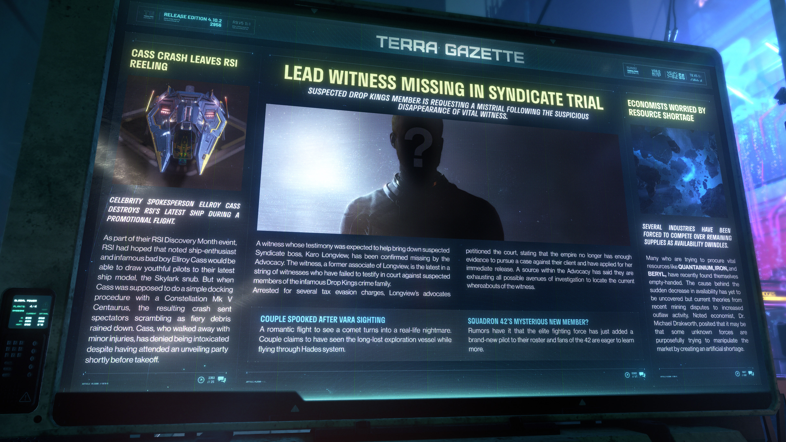

# Alpha 4.10.2：卡斯墜機重創 RSI、辛迪加審判核心證人失蹤、經濟學家擔憂資源短缺


**發佈版本：** 4.10.2 | **年份：** 2956 年 | **來源：** TERRA GAZETTE - 泰拉公報


---

<!-- **CASS CRASH LEAVES RSI REELING** -->

## 卡斯墜機重創 RSI

<!-- **CELEBRITY SPOKESPERSON ELLROY CASS DESTROYS RSI'S LATEST SHIP DURING A PROMOTIONAL FLIGHT.** -->

> **名人代言人埃爾羅伊·卡斯 (Ellroy Cass) 在宣傳飛行中摧毀了 RSI 的最新飛船。**

<!-- As part of their RSI Discovery Month event, RSI had hoped that noted ship-enthusiast and infamous bad boy Ellroy Cass would be able to draw youthful pilots to their latest ship model, the Skylark snub. But when Cass was supposed to do a simple docking procedure with a Constellation Mk V Centaurus, the resulting crash sent spectators scrambling as fiery debris rained down. Cass, who walked away with minor injuries, has denied being intoxicated despite having attended an unveiling party shortly before takeoff. -->

作為其「RSI 探索月」(RSI Discovery Month) 活動的一部分，羅伯茲太空工業 (RSI) 原本期望著名飛船愛好者兼惡名昭彰的「壞小子」埃爾羅伊·卡斯 (Ellroy Cass) 能夠吸引年輕飛行員關注他們的最新艦型——雲雀級 (Skylark) 艦載子機。然而，當卡斯理應對一艘星座五型 半人馬座 (Constellation Mk V Centaurus) 進行簡單的對接程序時，引發的墜撞事故導致燃燒的殘骸如雨般灑落，迫使現場觀眾四處逃竄。僅受輕傷脫險的卡斯否認涉嫌酒醉，儘管他在起飛前不久才剛參加過一場新船亮相派對。

<!-- **LEAD WITNESS MISSING IN SYNDICATE TRIAL** -->

## 辛迪加審判核心證人失蹤

<!-- **SUSPECTED DROP KINGS MEMBER IS REQUESTING A MISTRIAL FOLLOWING THE SUSPICIOUS DISAPPEARANCE OF VITAL WITNESS.** -->

> **在重要證人離奇失蹤後，空降之王 (Drop Kings) 嫌疑成員要求宣布審判無效。**

<!-- A witness whose testimony was expected to help bring down suspected Syndicate boss, Karo Longview, has been confirmed missing by the Advocacy. The witness, a former associate of Longview, is the latest in a string of witnesses who have failed to testify in court against suspected members of the infamous Drop Kings crime family.
Arrested for several tax evasion charges, Longview's advocates petitioned the court, stating that the empire no longer has enough evidence to pursue a case against their client and have applied for her immediate release. A source within the Advocacy has said they are exhausting all possible avenues of investigation to locate the current whereabouts of the witness. -->

倡導局 (The Advocacy) 已證實，一名原定出庭作證以扳倒辛迪加 (Syndicate) 嫌疑頭目卡羅·朗維尤 (Karo Longview) 的重要證人目前失蹤。該名證人曾是朗維尤的同夥，是一連串未能出庭指證惡名昭彰的犯罪家族「空降之王」(Drop Kings) 嫌疑成員的證人中的最新一名。
朗維尤因數項逃稅指控被捕，其辯護律師已向法院遞交請願書，聲稱帝國已不再擁有足夠的證據來起訴他們的委託人，並申請將其立即釋放。倡導局的一位消息人士表示，他們正在竭盡一切可能的調查途徑，以追查該名證人的下落。

<!-- **ECONOMISTS WORRIED BY RESOURCE SHORTAGE** -->

## 經濟學家擔憂資源短缺

<!-- **SEVERAL INDUSTRIES HAVE BEEN FORCED TO COMPETE OVER REMAINING SUPPLIES AS AVAILABILITY DWINDLES.** -->

> **隨著供應量日益減少，多個產業被迫爭奪剩餘的物資。**

<!-- Many who are trying to procure vital resources like QUANTAINIUM, IRON, and BERYL, have recently found themselves empty-handed. The cause behind the sudden decrease in availability has yet to be uncovered but current theories from recent mining disputes to increased outlaw activity. Noted economist, Dr. Michael Drakworth, posited that it may be that some unknown forces are purposefully trying to manipulate the market by creating an artificial shortage. -->

許多試圖採購量子礦 (Quantainium)、鐵 (Iron) 和綠柱石 (Beryl) 等關鍵資源的人，最近都發現自己空手而歸。供應量驟減背後的原因尚未查明，但目前的推測從近期的採礦爭端到非法勢力活動增加不一而足。知名經濟學家邁克爾·德拉克沃斯博士 (Dr. Michael Drakworth) 推測，可能是有某些未知勢力正蓄意透過製造人為短缺來操縱市場。

<!-- **COUPLE SPOOKED AFTER VARA SIGHTING** -->

## 目擊瓦拉號後一對情侶飽受驚嚇

<!-- A romantic flight to see a comet turns into a real-life nightmare. Couple claims to have seen the long-lost exploration vessel while flying through Hades system. -->

一場觀賞彗星的浪漫飛行演變成一場真實的噩夢。一對情侶聲稱在飛越哈迪斯星系 (Hades system) 時，看見了失蹤已久的探險船「瓦拉號」(Vara)。

<!-- **SQUADRON 42'S MYSTERIOUS NEW MEMBER?** -->

## 42 中隊神秘的新成員？

<!-- Rumors have it that the elite fighting force has just added a brand-new pilot to their roster and fans of the 42 are eager to learn more. -->

有傳言指出，這支精英作戰部隊剛剛在其名冊中增添了一名全新的飛行員，而 42 中隊 (Squadron 42) 的粉絲們都渴望了解更多詳情。
