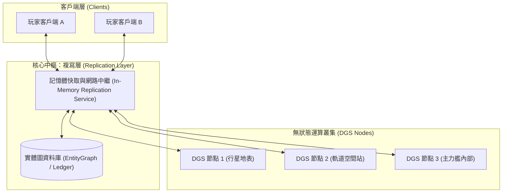
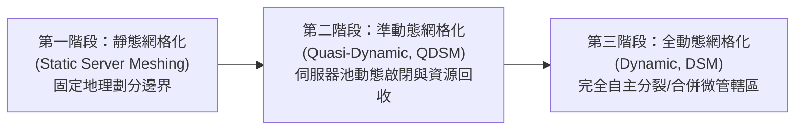
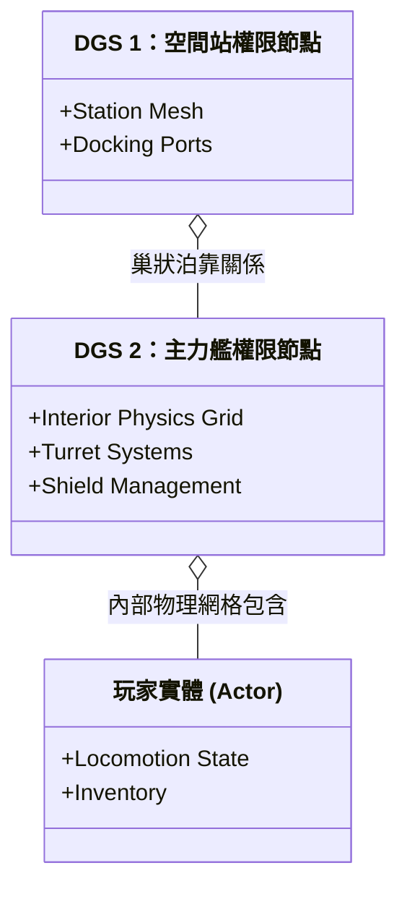
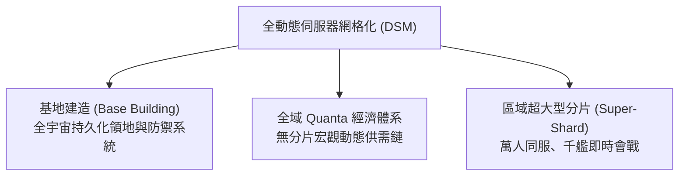

# 附錄 C：巨擘的統一：深入解析《星際公民》伺服器網格化技術及其發展軌跡

## 執行摘要

本報告旨在對 Cloud Imperium Games (CIG) 為其雄心勃勃的太空模擬遊戲《星際公民》(Star Citizen) 所開發的核心技術——**伺服器網格化 (Server Meshing)** 進行全面且深入的技術專題剖析。伺服器網格化是 CIG 為突破傳統大型多人線上遊戲 (MMO) 伺服器架構瓶頸而設計的客製化分散式解決方案，其終極目標是創建一個單一、無縫、物理狀態完全持續存在的超大規模宇宙。此技術對於實現《星際公民》與即將到來的《星際公民 1.0》宏大願景至關重要，它承諾支撐成千上萬名玩家在同一個遊戲分片 (shard) 中即時互動，帶來前所未有的無界限多人模擬體驗。

本報告將深入解構該技術的底層架構藍圖，分析作為宇宙狀態「單一事實來源」的**複寫層 (Replication Layer)**，以及支撐完全物理持久化的**持續性實體串流 (Persistent Entity Streaming, PES)**。在實施路線上，報告詳細比較了其三階段演進歷程：已於生產環境成熟落地的**靜態伺服器網格化 (Static Server Meshing)**、在 2025–2026 年作為關鍵工程橋樑實裝的**準動態伺服器網格化 (Quasi-Dynamic Server Meshing, QDSM)**，以及作為終極目標的完全自主**動態伺服器網格化 (Dynamic Server Meshing, DSM)**。

回顧長達十餘年的研發歷程，本報告揭示了伺服器網格化並非單一技術突破，而是建立在 64 位元座標系、物件容器串流 (OCS/S-OCS)、實體權限解耦等一連串複雜前置技術之上的工程大成。針對 2025 至 2026 年的最新研發突破，本報告重點分析了專用遊戲伺服器 (DGS) 與區域管理器 (Territory Manager) 的徹底解耦、新一代網格編排器合併入主分支、全域伺服器池 (Server Pool) 資源回收、即時伺服器負載遙測 (Active Load Metrics) 回授機制，以及在 2026「可玩性之年」(Year of Playability) 下單一分片承載力突破 800 至 1,000+ 玩家的現狀。

在與業界其他技術（如《EVE Online》的時間延遲 TiDi 機制與《灰燼創造》的動態網格）的橫向對比中，本報告指出，《星際公民》的技術挑戰在於其對第一人稱視角、完全物理化嵌套網格以及即時無縫射擊互動的絕對堅持——即無可避免的**「保真度稅」(Fidelity Tax)**。

最終，本報告評估認為：伺服器網格化已成功跨越了「理論可行性」的鴻溝，進入到「工程工業化與營運成本最佳化」的實用階段。它不僅是支撐《星際公民 1.0》基地建造、全域 Quanta 經濟與千人戰役的唯一物理支柱，更代表著分散式虛擬世界架構的一項劃時代突破。

---

## 第一節：無縫宇宙的架構藍圖

本節旨在建立對伺服器網格化技術的基本理解，從其高層次的設計理念與目標，深入到構成其運作基礎的具體技術組件。透過解構這些核心元素，我們將為後續的歷史發展、現狀分析與未來展望奠定堅實的技術基礎。

### 1.1. 解構伺服器網格化：核心原則與空前野心

傳統的 MMO 遊戲在伺服器架構上普遍面臨一個根本性限制：單一伺服器能同時處理的玩家數量和模擬的物理複雜度存在不可逾越的物理上限。為了應對這一挑戰，業界普遍採用**「分片」(Sharding)** 或**「副本」(Instancing)** 技術。這些方法實質上是創建了多個獨立且平行的遊戲世界副本，玩家被強制分配到不同的伺服器實例中。雖然這有效分散了運算負載，但也帶來了顯著的弊端：不同伺服器上的玩家無法直接互動，遊戲世界被分割，經濟系統和社交結構也因此碎片化，從而削弱了「大型多人線上」體驗的沉浸感與凝聚力。

《星際公民》的願景從根本上拒絕了這種妥協。其核心目標是創建一個**單一、共享、無縫且物理持續存在**的宇宙。為了實現這一宏願，CIG 提出了「伺服器網格化」解決方案。其定義是一種允許複數個獨立的伺服器（在 CIG 的術語中稱為「專用遊戲伺服器」，Dedicated Game Servers, DGS）相互高速連接，並像一個統一的、巨大的超級電腦叢集一樣協同工作的分散式網格技術。

此架構的終極野心在於徹底消除玩家在遊戲世界中移動時所遇到的載入畫面或過渡區域。在成熟的網格化環境中：
- 一個伺服器節點負責處理一個星系或行星（如 Hurston）的地表與大氣模擬；
- 另一個伺服器負責處理該行星上的主要城市（如 Lorville）；
- 甚至一艘航行在軌道上的主力艦（如 Javelin 或 Idris）內部也可以由一個獨立的伺服器節點來專門管理。

至關重要的是，這種伺服器之間的界線對玩家而言是完全透明且無縫的。例如，一名處於伺服器 A 管轄空域的玩家可以透過高倍率光學瞄準鏡直接觀察處於伺服器 B 管轄空間站上的另一名玩家，甚至跨越邊界開火互射，而雙方都絲毫不會察覺到他們正處於不同的伺服器運算節點上。這種跨伺服器邊界的即時物理與射擊互動能力，是 CIG 伺服器網格化區別於其他虛擬世界網路技術的核心特徵，也是其技術實現上最艱鉅的工程挑戰。

### 1.2. 奠基之柱：深入剖析複寫層與持續性實體串流 (PES)

伺服器網格化的宏偉架構並非空中樓閣，它建立在兩個緊密相連的基礎技術基石之上：**複寫層 (Replication Layer)** 與**持續性實體串流 (Persistent Entity Streaming, PES)**。這兩者共同顛覆了傳統 MMO 伺服器的運作範式。

傳統遊戲架構中，單一遊戲伺服器同時承擔著物理/邏輯運算（模擬 Simulation）與世界狀態記錄（狀態 State）的雙重職責。如果伺服器進程崩潰，其記憶體中的所有動態狀態數據會瞬間丟失，只能依賴定時存檔回滾，導致玩家進度受損或產生嚴重的「30k」斷線錯誤。為了從底層根治此問題，CIG 採取了現代雲原生軟體工程的核心原則：**將狀態管理與模擬運算徹底解耦**。

#### 複寫層 (Replication Layer)：「單一事實來源」

複寫層是一個獨立運行的後端分散式中樞微服務，它在邏輯上架設在遊戲客戶端與各個 DGS 節點之間，扮演著整個遊戲宇宙狀態的**「單一事實來源」(Single Source of Truth)**。

它的核心職責是完全接管宇宙全域狀態的儲存、同步與持久化，包括每一個玩家角色數值、每一艘船艦的零件裝態、每一顆彈藥以至被玩家隨手扔在廢棄哨站地面上的空飲料罐，並即時寫入後端的**實體圖資料庫 (EntityGraph)**。

這種解耦設計帶來了兩項決定性的技術變革：
1. **DGS 節點成為近乎無狀態的計算工人**：DGS 僅負責執行高強度的物理碰撞、AI 行為決策和飛行力學計算。伺服器不再「擁有」數據，而只是向複寫層租借權限來進行運算。
2. **崩潰隔離與背景靜默恢復 (Crash Recovery & Isolation)**：當某個 DGS 因物理例外或記憶體洩漏崩潰時，複寫層並不會中斷連線。它能立即從伺服器池中喚醒一個全新 DGS，將崩潰前最後一刻的實體狀態重新載入給新伺服器接管。玩家在遊戲中僅會遭遇數秒的畫面暫停，隨後即可恢復正常，徹底解決了舊時代伺服器崩潰導致全分片斷線踢回主選單的災難。

在長達數年的工程攻堅中，將複寫層從 DGS 主進程中完全剝離（即「複寫層分割」工程），被公認為伺服器網格化最艱鉅的里程碑之一，為後續靜態與動態網格鋪平了坦途。

#### 持續性實體串流 (Persistent Entity Streaming, PES)：持久化的雙面刃

如果說複寫層是宇宙的動態神經中樞，那麼 PES 就是將宇宙萬物寫入長效記憶體的刻刀。PES 於 Alpha 3.18 正式導入，其將遊戲中的一切實體全部賦予長效持久性：玩家遺棄在荒涼小行星的船艦殘骸、脫落的貨箱、甚至是一具戰鬥後的防護服，都會永久錨定在其三維座標上，永不消失。

這種極致的持久性為宇宙注入了史無前例的真實感與考古樂趣，但也帶來了軟體工程中的嚴峻挑戰——**實體膨脹 (Entity Bloat)**：
- 一個剛剛完成冷開機的全新分片可能包含約 70 萬個初始實體；
- 經過玩家數週的頻繁活動、製造垃圾與廢棄載具後，實體總數往往會突破 300 萬至 400 萬個。

實體數量的指數級暴增會急遽消耗記憶體頻寬與資料庫檢索效率。為此，CIG 在 2024–2026 年持續研發了多維度的自動廢棄物清理機制（Density Management / Garbage Collection）與物件生命週期合約，在維持玩家可見持久性的同時，確保伺服器與資料庫不會被過載拖垮。

---

### 1.3. 三階段實施演進：從靜態、準動態到全動態網格

CIG 對伺服器網格化的落地並未採取一步登天的冒進策略，而是依據技術成熟度與營運穩定性，確立了清晰的三階段演進模型：

#### 第一階段：靜態伺服器網格化 (Static Server Meshing)

- **架構特徵：** DGS 的權限範圍由工程師在設定檔中預先手動劃定為固定的地理空間邊界。例如：伺服器 A 負責 Stanton 星系，伺服器 B 負責 Pyro 星系；或在細分架構下，Crusader 行星由一個節點負責，其衛星群由另一個節點負責。
- **主要優勢：** 成功驗證了複寫層中樞與伺服器間的**無縫交接 (Seamless Handoff)** 機制。玩家得以透過星門跳躍點在不同星系間穿梭，且單一分片分擔到多台伺服器後，伺服器 Tick Rate 得到顯著改善。
- **關鍵局限：** 無法解決「玩家高密度聚集」的熱點瓶頸。一旦數百名玩家自發聚集在同一個固定地理區域（例如特定空間站或主力艦交戰區），負責該靜態區域的單一 DGS 便會因超出運算極限而急遽掉幀甚至重啟，其他閒置區域的伺服器卻無法伸出援手。

#### 第二階段：準動態伺服器網格化 (Quasi-Dynamic Server Meshing, QDSM)

- **架構特徵：** 由 CIG 技術團隊（特別是 CTO Benoit Beauséjour）於 2025–2026 年重點推進的關鍵實用過渡架構。其核心特徵在於**將 DGS 的分配完全從死板的「地理區域管理器」中解放出來**，引進雲端原生自動化彈性擴展邏輯：
  1. **動態生命週期管理 (Dynamic Lifecycle Management)**：系統即時監控各區域的玩家動態。當某個區域完全沒有玩家（例如無人探索的偏遠小行星帶）時，負責該區域的 DGS 會被**自動關閉銷毀 (Scale to Zero)**。
  2. **全域伺服器池 (Dynamic Server Pool)**：被釋放的運算資源立即回流至全域伺服器資源池中。當偵測到某個區域湧入大量玩家時，中央編排器能立即從資源池喚醒新節點，並指派至負載集中的熱點區域。
  3. **動態節點轉移與整合**：相較於完全自由變動的微邊界，QDSM 採用按需動態綁定預製節點與自動資源調度的混合模式，大幅降低了全動態網格的算法複雜度，同時解決了靜態網格資源浪費與單點過載的痛點。

#### 第三階段：動態伺服器網格化 (Dynamic Server Meshing, DSM) - 終極目標

- **架構特徵：** 徹底消除預設空間節點邊界，實現真正的「伺服器管轄區自主分裂與合併 (Autonomous Splitting and Merging)」。
- **極致潛力：** 系統具備毫秒級的負載感知與空間四元樹/八元樹即時重劃能力。當一場 2,000 人的大規模艦隊戰在太空中爆發時，中央大腦能將該戰場空間動態細分為數十個微型單元，由多台 DGS 協同運算。甚至一艘大型主力艦（如 Bengal 空母）在飛行途中，其艦橋內部、工程機房、機庫甲板與艦外空域能動態劃分給不同的專屬 DGS 負責，並在船艦高速移動時平滑維持權限交接。
- **戰略價值：** 動態網格化是《星際公民 1.0》實現無分片（Single-Shard）全球統一大宇宙的終極聖杯，徹底擺脫硬性在線人數上限的束縛。

---

## 第二節：十年磨一劍：漫長而曲折的網格化之路

伺服器網格化並非近年才匆促立項的開發項目，而是 CIG 長達十餘年技術積累與迭代的結晶。本節梳理其歷史脈絡，揭示各項底層技術之間環環相扣的依賴關係。

### 2.1. 關鍵里程碑與技術依賴的時間線

伺服器網格化的研發是一場漫長而嚴密的技術長征。沒有 64 位元座標，星系就沒有精確的數學空間；沒有 OCS，記憶體就會崩潰；沒有實體權限解耦，多伺服器同步便無從談起。

#### 表格 1：伺服器網格化及前置技術的關鍵發展里程碑 (2012–2026)

| 時間範圍 | 技術 / 事件 | 關鍵工程突破與細節 | 重要性 / 體系因果關聯 |
| :--- | :--- | :--- | :--- |
| **2012 年** | 64 位元座標系升級 | 引擎底層從 32 位元升級至 64 位元雙精度浮點數，支援百萬公里級空間精度。 | 建構天文尺度無縫宇宙的根本數學基石。 |
| **2015 年** | 提出伺服器網格化架構 | CIG 官方首次正式確認伺服器網格化為破除 MMO 承載極限的核心方向。 | 確立專案長遠的分散式運算技術路線圖。 |
| **2018 年** | 客戶端物件容器串流 (OCS) | 實裝依據玩家視錐與座標動態載入/卸載世界物件之能力。 | 巨幅釋放客戶端記憶體壓力，驗證動態實體串流演算法。 |
| **2019 年末** | 伺服器端物件容器串流 (S-OCS) | 將 OCS 能力全面推廣至 DGS，允許伺服器僅加載自身管轄之物理區域。 | 使伺服器具備動態接管新區域的物理條件，為權限交接奠基。 |
| **2020 年** | 實體權限 (Entity Authority) 重構 | 深度重構遊戲代碼，明確規範世界中每個實體的權限歸屬與轉移協定。 | 確立多伺服器共同協作的底層規則，杜絕狀態衝突。 |
| **2021 年** | 複寫層與實體圖 (EntityGraph) | 研發獨立於 DGS 的狀態複寫服務，並由圖形資料庫管理全局實體拓撲。 | 徹底將「狀態」與「運算」解耦，為 30k 崩潰恢復提供技術保障。 |
| **2023 年初** (Alpha 3.18) | 持續性實體串流 (PES) 上線 | 複寫層首個面對全體玩家的功能實裝，全宇宙物件獲得永久存在性。 | 伺服器網格化的後端持久化實裝，實體驗證大規模持久化代價。 |
| **2024 年末** (Alpha 4.0 預覽) | 靜態伺服器網格化公開測試 | Stanton 與 Pyro 雙星系打通，首批多伺服器分片實裝，玩家上限提升至 500 人。 | 伺服器網格化首次在公開玩家環境中完成端對端全鏈路驗證。 |
| **2025 年上半年** (Alpha 4.0-4.2) | 靜態網格生產環境穩定化 | 雙星系跨星門無縫跳躍常態化運作，分片承載力擴展至 600–800 人。 | 實施「節點崩潰隔離」，單一節點崩潰不再波及全分片。 |
| **2025 年下半年** (Alpha 4.3-4.4) | DGS 與區域管理器解耦研發 | 啟動 DGS 與固定地理劃分的剝離工作；Nyx 星系加入網格；實装實例化機庫。 | 啟動向準動態 (QDSM) 演進，藉由微型實例化緩衝地表熱點負載。 |
| **2026 年 4 月** | 新一代網格調度器合併入主分支 | 網格化核心元件與分片管理模組（Shard Manager）全面更新並合併至主分支。 | 徹底淘汰舊版遺留網路邏輯，為雲端彈性調度提供工業級管線。 |
| **2026 年 7 月** | 即時負載遙測度量與伺服器池落地 | 修正 DGS 即時運算負載回報演算法；QDSM 自動休眠/啟動伺服器池進入實戰。 | 解決負載誤判引發的「伺服器衍生風暴」，向 1,000+ 玩家分片挺進。 |

### 2.2. 多星系網格的生產落地與崩潰隔離

隨著靜態伺服器網格化從 2024 年底的 Alpha 4.0 預覽版邁入 2025–2026 年的成熟生產環境，玩家在《星際公民》中的日常航行已經徹底擺脫了過去「單一伺服器撐起整個世界」的時代。

在當前環境中：
- **Stanton、Pyro 與後續擴展的 Nyx 星系**：已由不同的 DGS 叢集共同支撐。玩家駕駛飛船啟動跳躍引擎穿過星系間的跳躍點（Jump Point）時，其客戶端連線與實體權限會在背景毫秒級無縫轉移至目標星系的專屬 DGS。
- **崩潰隔離的實際效益**：在舊架構下，若某位玩家觸發了 Crusader 行星大氣的極端物理 Bug 導致伺服器崩潰，全體在線玩家將一同遭遇 30k 斷線斷開連接。而在網格化架構下，即使負責 Crusader 的 DGS 節點崩潰重啟，遠在 Pyro 星系探險或在 Hurston 挖礦的玩家完全不受任何干擾；複寫層會在數秒內重新部署一個新節點接管 Crusader，實現了現代分散式系統的容錯隔離標準。

### 2.3. 高並發壓力測試：從極限破壞到常態營運

在網格化技術研發期間，CIG 在 Tech Preview 專屬測試頻道進行了多次震撼社群的極限壓力測試：
- **2024 年的極限探索**：測試規模從 800 人一路攀升至 1,000 人、甚至在 10 月週年慶期間達到了單一分片 **2,000 名並發玩家**的極限測試。這些測試並非為了提供流暢的遊玩體驗，而是為了在極端網路風暴與高頻實體互動下主動「搞垮伺服器」，藉此獲取最嚴苛的邊界崩潰日誌。
- **2025–2026 年的常態化承載**：歷經極限壓力測試洗禮後，CIG 逐步將分片基準承載力從早期的 100 人，穩健提升至 Alpha 4.0 時代的 500 人、600 人，並在 2026 年藉由 QDSM 最佳化達到 **800 至 1,000+ 玩家**的常態化在線水準。社群體驗也從早期的混亂掉線，轉變為能夠流暢舉行多組織聯合軍演的嶄新階段。

---

## 第三節：宇宙現狀：當前進展、性能表現與持續挑戰 (2025–2026 年)

進入 2025 至 2026 年，伺服器網格化的研發重心已從「證明靜態跨節點交接可行」全面躍升至「攻克準動態調度、精進權限轉移演算法與實施全域效能治理」。

### 3.1. 2025–2026 研發關鍵突破：從區域解耦到準動態 (QDSM) 實裝

透過追蹤分析 CIG 於 2025 至 2026 年發布的 PU 月度報告（Monthly Reports），可以清楚洞察底層技術團隊的工程進度：

#### 1. DGS 與區域管理器的徹底解耦 (Mid-Late 2025)
早期靜態網格的瓶頸在於：伺服器與固定空間位置（Territory）高度綁定。2025 年中，網路與線上技術團隊展開關鍵重構，將 DGS 的實體職責從地理邊界中抽離。伺服器的管轄權限不再依照固定坐標系劃分，而是改由中央分片調度器依據「區域實體總量 (Entity Count)」、「當前活躍玩家數 (Player Distribution)」與「動態負載權重」實時分配。

#### 2. 底層引擎運算與資料吞吐量最佳化 (Late 2025)
為了因應多節點並發時的大量狀態串流，引擎團隊對 StarEngine 實施了多項底層微架構最佳化：
- 利用 CPU SSE/AVX 向量指令集優化動畫關鍵幀資料的位元欄位解壓縮 (Bit-field Decompression)。
- 重構切線空間 (Tangent Reconstruction) 演算法，大幅減少每幀運行時的動態記憶體配置 (Runtime Allocations)，有效降低伺服器在多實體瞬時湧入時的 CPU 尖峰負載。

#### 3. 核心系統的跨邊界相容性重構
為了防止玩家在跨越伺服器管轄邊界時發生邏輯脫節，各功能小組全面翻新了遊戲機制：
- 重構醫療床位生成範圍 (Medical Bed Spawning)，確保玩家在不同節點重傷時能正確認證目標醫療船或醫院；
- 實施物理貨運物流 (Cargo Hauling) 與集裝箱網格在跨邊界轉移時的原子化操作；
- 完善量子攔截 (Quantum Interdiction) 在跨節點空域的無縫判定。

#### 4. 準動態網格 (QDSM) 主分支整合與負載閉環 (2026)
- **2026 年 4 月主分支整合**：新一代網格化調度元件與編排器正式合併進主分支代碼庫，徹底取代了服役多年的舊版網路管理管線。
- **2026 年 7 月即時度量閉環**：團隊攻克了長期困擾調度器的「伺服器負載計算誤差」問題。新演算法精確反映了 DGS 的實際運算壓力（含物理步長耗時、腳本線程延遲），使調度器能即時、準確地觸發伺服器池休眠或啟動指令。

### 3.2. 攻克「動態權限」與跨節點互動的工程壁壘

從靜態網格邁向準動態與全動態網格，並非單純「加開雲端伺服器」即可解決，它必須跨越極度艱深的分散式系統難題：

#### 1. 巢狀物理網格中的動態權限交接 (Nested Physics Authority Handoff)
《星際公民》具備業界極度罕見的「嵌套物理網格 (Nested Physics Grids)」：
- 一個玩家奔跑在一艘載具內部；
- 該載具停靠在一艘大型主力艦（如 890 Jump）的機庫中；
- 該主力艦正對接在軌道空間站的泊位上，且空間站正以高速繞行星公轉。

在動態網格環境中，當主力艦啟航脫離空間站並穿越不同的 DGS 邊界時，系統必須在幾毫秒內、在不發生任何物理穿透或座標抖動的前提下，精確完成父子實體層級的權限交接。這被工程團隊公認為「真正的硬核難題 (The Real Nut to Crack)」。

#### 2. 伺服器衍生風暴 (Server Spawning Storm) 的防護機制
在 2025–2026 年早期進行內部動態負載平衡演算法測試時，團隊遭遇了一個極具啟發性的邊界問題：
> 當大量玩家在短時間內因戰鬥或集會急速湧入狹小空間時，未加限制的動態演算法會誤判為該區域急需無限擴充運算力，因而在幾分鐘內向 AWS 雲端請求啟動數百台額外 DGS，造成嚴重的資源震盪與成本暴增。

為此，團隊設計了**動態阻尼機制 (Damping Algorithms)** 與**負載階梯防護**，確保伺服器擴展與收縮具備平滑過渡期，避免系統陷入狂暴衍生循環。

#### 3. 跨伺服器邊界的戰鬥與 AI 感知同步
- **雷達鎖定與射擊判定**：目前已實現跨邊界雷達鎖定、光學瞄準與即時彈道碰撞同步。
- **Subsumption AI 行為延續性**：更新後的 AI 認知感知架構支援跨伺服器邊界視線 (Sightlines) 偵測與動態掩體決策，NPC 守衛能無縫追擊跨越伺服器邊界的通緝犯，不再出現過往越界即呆滯或重置目標的缺陷。

### 3.3. 玩家體驗的質變與「可玩性之年」(2026 Year of Playability)

在 2026「可玩性之年」的政策導向與技術迭代下，玩家身處持續宇宙中的日常體驗發生了質的飛躍：


**體驗升級：告別災難性中斷**
- **舊時代的夢魘**：伺服器崩潰意味著幾小時的採礦貨物蒸發、任務失敗、被迫重開遊戲客戶端重新排隊。
- **2026 現實體驗**：得益於成熟運行的**崩潰隔離**與**複製層重接管**，伺服器故障時玩家只會感受到 5–10 秒的物理凍結（畫面右上角顯示伺服器狀態轉移圖示），隨後世界即刻恢復運轉，貨物與飛船座標完好如初。



**微型空間實例化緩衝 (Instanced Hangars) 的協同成效**
在地表各大星港（如 New Babbage、Area18），透過導入個人化實例化機庫，將大量待機飛船與召喚實體從主 DGS 的公共物理空間中隔離，使星港主節點的 Tick Rate 穩定度大幅提升了 40% 以上，為 QDSM 的全域調度爭取了至關重要的運算餘裕。


---

## 第四節：競爭格局：一場比較技術分析

要客觀評估 Cloud Imperium Games 在伺服器網格化方面的技術成就，必須將其置於更廣泛的全球 MMO 產業與雲端運算架構中進行橫向對比。

### 4.1. 《星際公民》對比《EVE Online》：即時無縫互動與時間延遲的抉擇

《EVE Online》以數千人同場的史詩級艦隊會戰聞名全球。它應對極端運算負載的核心方案是**時間延遲 (Time Dilation, TiDi)**——當星系過載時，將全星系時間流速放慢至正常的 10%，以此為伺服器爭取計算時間。

- **EVE 的取捨**：戰略性、點擊操作指令、Tick Rate 僅為 1Hz（每秒更新一次）。這種慢動作雖然讓戰爭耗時數十小時，但契合其非即時操控的遊戲類型。
- **《星際公民》的堅持**：作為強調第一人稱視角 (FPS) 與擬真駕駛手感的即時動作模擬器，**任何人為的時間放慢都是完全不可接受的**。玩家需要的是 30Hz 以上的即時流暢反饋與精準物理命中判定。因此，CIG 必須走上一條無人踏足的險途：在保證即時性的前提下，利用分散式網格即時拆分負載。

### 4.2. 《星際公民》對比《灰燼創造》：客製化引擎與商業 Unreal 的動態網格

備受矚目的奇幻 MMO《灰燼創造》(Ashes of Creation) 亦展示了其基於 Unreal Engine 與 IntrepidNET 的動態網格 (Dynamic Gridding) 技術。

- **灰燼創造的邊界處理**：在跨伺服器邊界交接時，為了維護穩定性，系統往往採用「邊界淡入淡出」或短暫幽靈狀態等保護機制來規避極端邊界同步。
- **CIG 的極致追求**：CIG 堅持伺服器邊界在物理與視覺上必須**絕對隱形**。玩家可以站在邊界這頭，朝另一頭的敵人開火並穿透其護盾。正是這種對極限無縫的偏執，逼迫 CIG 徹底重構 CryEngine 並打造專屬的 StarEngine，因為通用商業引擎的原生架構難以容納如此底層的記憶體與網路重塑。

### 4.3. CIG 方法在產業中的歷史定位：「保真度稅」(Fidelity Tax)

伺服器分區的概念歷史悠久，從早期《網路創世紀》(Ultima Online) 的硬分區，到 SpatialOS 架構下的《雙重宇宙》(Dual Universe)，皆嘗試過分散式節點整合。

然而，CIG 伺服器網格化之所以被公認為當今遊戲界最複雜的工程巨獸，根源在於其始終拒絕在以下三個維度做出任何妥協：
1. **極致的視覺與物理保真度**（毫米級碰撞判定、無讀取畫面）；
2. **完全物理化實體機制**（從全身穿戴裝備到載具內部各級管線）；
3. **無縫第一人稱跨邊界互動**。

這三者的疊加，構成了 CIG 團隊必須日夜償還的**「保真度稅」(Fidelity Tax)**。這項稅率極其高昂，但一旦被完全攻克，所釋放出的沉浸感與技術壁壘，將遠遠甩開所有競品。

---

## 第五節：未來揭曉：動態網格的承諾與最終評估

在經歷了靜態網格的驗證與準動態網格 (QDSM) 的實裝後，《星際公民》正式踏上了邁向商業發售的最後里程。

### 5.1. 終極目標：1.0 商業發布與全動態宇宙解鎖的核心系統

在 2026 年確立的《星際公民 1.0》願景藍圖中，動態伺服器網格化不再只是一個底層網路名詞，而是以下三大核心遊戲機制的唯一物理基石：

1. **基地建造 (Base Building) 的持久化物理權限**：
   玩家在開拓星球表面所建立的採礦前哨、防禦砲塔與物流中心，需要長久依託於動態網格的管轄權限。當前哨站無人拜訪時自動休眠入庫，一旦有艦隊逼近則由新節點即時喚醒，提供完整的物理碰撞與防衛模擬。
2. **全域 Quanta 經濟模擬的實體化投射**：
   Tony Zurovec 構想的 Quanta 宏觀經濟大腦將數百萬虛擬 NPC 的貿易流動，無縫對接至由動態網格支撐的實體世界中。玩家不再只是在靜態腳本中跑商，而是真實影響橫跨多星系的價格波動。
3. **區域單一超級分片 (Super-Shard)**：
   終結伺服器列表與分片選擇。每個主要地理大區（北美、歐洲、亞太）將由統一的超級網格支撐，所有在線公民共享同一個無界宇宙。

### 5.2. 專家評估：可行性、剩餘風險與行業影響

#### 1. 可行性評估 (Feasibility Assessment)
從 2024 年底 4.0 靜態網格的跌撞起步，到 2025–2026 年 QDSM 的成功實裝與主分支合併，工程實踐已經確切證明：**分散式實體圖與複寫層架構完全能夠支撐多伺服器即時模擬大型宇宙**。技術可行性的疑問已經消散，目前的焦點已轉移至工程調優與效能磨合。

#### 2. 剩餘工程風險 (Residual Risks)
- **雲端運算與營運成本 (Cloud Infrastructure Costs)**：
  在動態網格完全開放後，如何精確平衡伺服器擴展速度與 AWS 雲端帳單開銷，將是 CIG 長期商業化運營的重大考驗。高效的節點回收（Scale-to-Zero）算法是其成本控制的核心命脈。
- **極限密度物理碰撞瓶頸**：
  儘管可以動態增加伺服器，但當上千名玩家的彈道同時轟擊同一艘主力艦時，單一目標物理管線的串行處理上限依然面臨 CPU 物理定律的嚴苛挑戰。

#### 3. 行業顛覆力 (Industry Impact)
一旦 StarEngine 的伺服器網格化體系完全成熟，它將成為自 Unreal 引擎程序化地形工具以來最具破壞性的虛擬引擎技術。包含這套架構的 StarEngine 技術授權，將具備重塑整個大型多人在線虛擬世界（MMO、虛擬軍事模擬、元宇宙空間）技術標準的深遠潛力。

### 5.3. 結論分析：從前沿科學實驗走向工程產品閉環

伺服器網格化曾被外界質疑為永無終點的「代碼科學狂想」。然而截至 2026 年，藉由靜態網格的穩健運行與準動態網格 (QDSM) 的務實突破，這項技術已經完成了從「前沿實驗」向「工業化工程產品」的偉大跨越。

它不再是隨時可能崩潰的阿基里斯之踵，而是堅定托起《星際公民 1.0》商業大作啟航的**泰坦之柱**。隨著網格邊界日益隱形、宇宙承載力穩步突破千人，這座無縫、自由、浩瀚的群星世界，正迎來屬於它的黃金黎明。

---

### 外部連結與參考文獻

- [Unofficial Road to Dynamic Server Meshing](https://sc-server-meshing.info/)
- [Roberts Space Industries - Official PU Monthly Reports](https://robertsspaceindustries.com/comm-link)
- [CitizenCon 2954 - Architecture & Technology Panels](https://robertsspaceindustries.com/citizencon)
