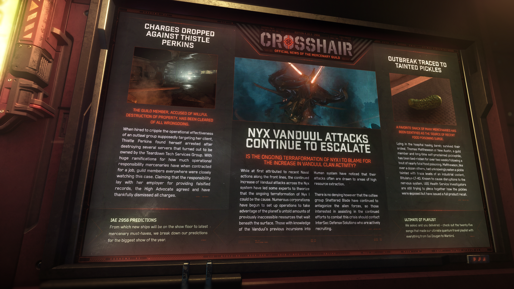

# Alpha 4.10.3：尼克斯星系剜度攻擊持續升級、薊花·珀金斯獲撤銷指控、受污染酸黃瓜引發疫情


**發佈版本：** 4.10.3 | **年份：** 2956 年 | **來源：** CROSSHAIR - 準心 (傭兵公會官方新聞)


***

## 尼克斯星系剜度 (Vanduul) 攻擊持續升級

> **尼克斯 I (Nyx I) 正在進行的地球化改造是否該為剜度氏族活動的增加負責？**

雖然起初將其歸咎於近期前線的海軍行動，但遍布整個尼克斯星系的剜度 (Vanduul) 攻擊持續增加，已使一些專家推測正在進行的尼克斯 I (Nyx I) 地球化改造可能是罪魁禍首。眾多企業已開始設立營運據點，以利用地表之下等待開採、以往難以取得的龐大資源。那些了解剜度先前入侵人類星系歷史的人士注意到，他們的攻擊往往會被高資源開採區域所吸引。

然而不可否認的是，非法組織「碎刃幫」(Shattered Blade) 持續挑釁這支外星勢力，因此有興趣協助持續對抗這場危機的人員，應聯繫正積極招募的互安防衛 (InterSec Defense Solutions)。

## 薊花·珀金斯 (Thistle Perkins) 獲撤銷指控

> **該名遭指控故意破壞財產的公會成員，已獲洗清所有罪嫌。**

在受雇削弱一個據稱以其客戶為目標的非法組織之運作效能時，薊花·珀金斯 (Thistle Perkins) 摧毀了數台伺服器，結果卻發現這些伺服器屬於拆解科技服務集團 (Teardown Tech Services Group)，隨後遭到逮捕。鑑於傭兵在簽署工作合約時應承擔多少作業責任具有重大深遠影響，各地的公會成員都高度關注此案。珀金斯主張其雇主提供造假紀錄應承擔全責，倡導局高等法官 (The High Advocate) 對此表示認同，並慶幸地撤銷了所有指控。

## 中毒疫情源頭追溯至受污染酸黃瓜

> **許多傭兵喜愛的點心被確認為近期食物中毒激增的源頭。**

來自新奧斯汀 (New Austin) 的公會成員、長年自詡為酸黃瓜狂熱者的托馬斯·馬修森 (Thomas Matthewson)，在一場險些致命的食物中毒後已臥床超過兩週，在醫院裡歷經磨難才勉強存活。馬修森與十多名其他人一樣，在不知情的情況下食用了受微量工業冷卻劑 Bitulanye-LT-40 污染的酸黃瓜。已知該冷卻劑會對神經系統造成損害，聯合地球帝國衛生署 (UEE Health Service) 調查人員仍在試圖拼湊酸黃瓜是如何遭受污染的經過，但已發布了全面的產品召回令。

## IAE 2956 預測

從展場上將亮相的新飛船，到傭兵最新的必備裝備，我們為這場年度最盛大的展覽整理了詳細預測分析。

## 終極 QT 量子旅行歌單

我們廣徵意見而你們熱烈回應——來聽聽入選我們終極量子旅行 (QT) 歌單的 25 首歌曲，內容涵蓋從 Gal Dougan 到 Warbird 的所有精彩曲目。
